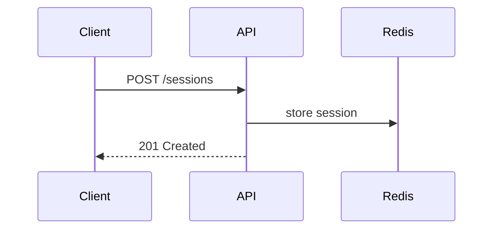

# Writing docs

Write a feature doc for each new feature, and an architecture decision record (ADR) for each major decision. The rules for both are in this file. The templates contain structure only.

## When to write

Write the feature doc before or alongside the code, and update it whenever the feature changes.

Write an ADR when a decision meets any of these:

- it is costly to reverse later
- it picks between real alternatives, such as a library, data store, protocol, or pattern
- it adds a dependency or a new technology
- it changes a public interface, data format, or schema
- it spans more than one component, service, or team
- the user made a deliberate call that a future reader would otherwise question

When unsure, write the ADR. It is short.

## Where docs go

Follow the project's existing layout if it has one. Otherwise:

| Doc | Path | Template |
|-----|------|----------|
| Feature doc | `docs/features/<feature-name>.md` | [templates/feature.md](templates/feature.md) |
| ADR | `docs/adr/NNNN-<decision-title>.md` | [templates/adr.md](templates/adr.md) |

Names are lowercase kebab-case. ADR numbers have four digits and count up from `0001`. Don't keep a separate list of ADRs, because the folder listing is the index.

To start a doc, copy its template and fill in the sections, removing the HTML guidance comments as you go. Delete a section that has nothing to say rather than writing "N/A" in it.

## State each fact once

Write each fact in one place. Other docs link to that place.

- A feature doc lists the decisions it depends on and links to their ADRs. It doesn't repeat their reasoning.
- An ADR links to the feature doc for background. It doesn't retell the feature.
- Link to code, config, and schemas by path instead of pasting them. Paste a snippet only when the doc explains that snippet.
- Link to the heading that contains the fact, with a relative link such as `[retry policy](../features/sync.md#retry-policy)`.
- READMEs, `CLAUDE.md`, and code comments link to the doc with the fact instead of summarizing it.
- When the same fact appears in two places, delete the weaker copy and link to the other.

Before adding a fact, search the docs for it. If it already exists, link to it.

## Edit in place

A doc describes the current state. When the design changes or a revision is requested, rewrite the affected text so the doc reads as if it had always said the new thing.

Never add:

- revision history, changelog, or "Updates" sections
- "previously", "now", "originally", "no longer", "changed from", or "as discussed" about an earlier draft
- version or date labels on sections, such as "(v2)" or "Updated 2026-03-01"
- struck-through text, or notes about what was removed

Git keeps the history. Describe a past state only when the past state is the subject, as in the context section of an ADR.

### ADR lifecycle

While an ADR has `status: proposed`, revise it in place like any other doc.

Once its status is `accepted`, its decision is fixed. If the decision changes:

1. Write a new ADR for the new decision, and link to the old one from its context.
2. In the old ADR, change only the front matter, to `status: superseded` and `superseded-by: NNNN-title.md`.
3. Point the feature docs at the new ADR.

Typo and broken-link fixes in an accepted ADR are fine.

## Style

- Lead with the point. Use short sentences, plain words, and the active voice.
- Write for a reader who knows the codebase but wasn't in the conversation.
- Use lists and tables for parallel facts, and prose for reasoning.
- Cut preambles, previews of what a section will say, and closing recaps.

## Diagrams

Draw diagrams in [Mermaid](https://mermaid.js.org) code blocks, so they render on GitHub and change in the same diff as the text. Don't use ASCII art or image files.

Use the diagram type that matches the subject:

| Subject | Mermaid type |
|---------|--------------|
| Control flow, components | `flowchart` |
| Interactions over time | `sequenceDiagram` |
| Lifecycles | `stateDiagram-v2` |
| Data models | `erDiagram` |

Add a diagram when it shows structure that prose can't show briefly, and leave it out when it would only repeat a short paragraph. A diagram goes in the same single place as the facts it shows, and other docs link to it. Use short node labels, and put explanations in the surrounding prose.



A hook runs [Vale](https://vale.sh) with [vale-ai-tells](https://github.com/tbhb/vale-ai-tells) after every `.md` write and sends you its findings. Fix each finding by rewriting the passage. Add a suppression comment only for a false positive, such as a quoted term or a literal name, and scope it to that one rule and passage:

```markdown
<!-- vale ai-tells.RuleName = NO -->
The passage that quotes the flagged term.
<!-- vale ai-tells.RuleName = YES -->
```
